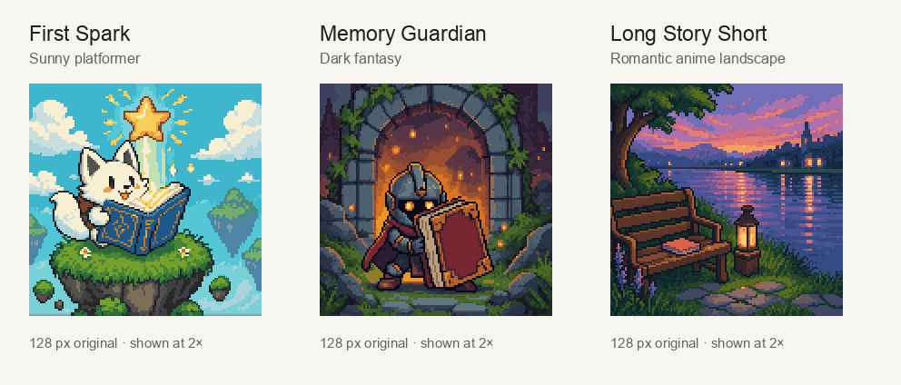
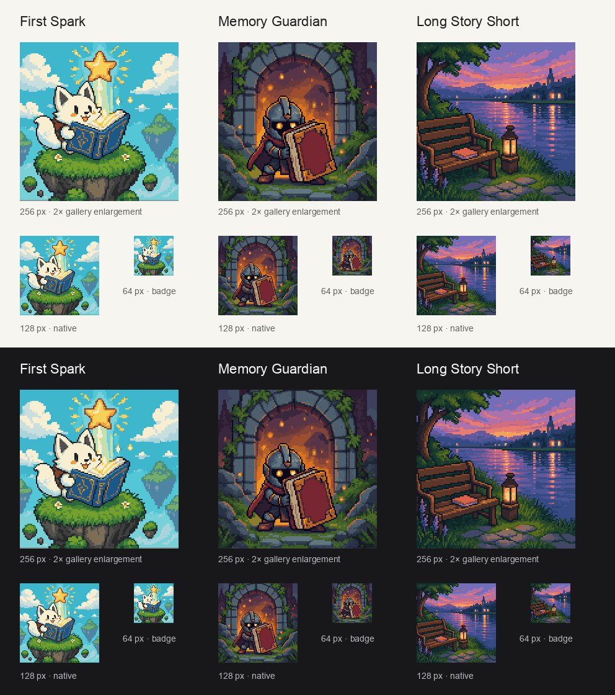

# First Edition — three PixelLab samples

Generated 18 November 2026 after owner authorization. **Themes approved; Memory Guardian and Long Story Short approved unchanged. First Spark revised to a white fox at the owner's request.** This is the original three-sample archive. The [complete 39-artwork collection](../first-edition/README.md) has since been generated and reviewed. No achievement or gallery application code is implemented by this asset pass.

| Achievement | Theme | Native PNG | 64 px thumbnail |
| --- | --- | --- | --- |
| First Spark / はじまりのひらめき | Sunny platformer / white fox | [128 px](first-spark-fox-v2.png), 9,633 bytes | [64 px](first-spark-fox-v2-64.png), 5,059 bytes |
| Memory Guardian / 記憶の守り人 | Dark fantasy | [128 px](memory-guardian.png), 16,017 bytes | [64 px](memory-guardian-64.png), 7,956 bytes |
| Long Story Short / 気づけば半年 | Romantic anime landscape | [128 px](long-story-short.png), 13,964 bytes | [64 px](long-story-short-64.png), 6,947 bytes |

All current source images are opaque, static, native 128×128 PNGs with 26–32 colors. PixelLab Pro Flash generated the three initial themes independently. The owner then requested a fox instead of the chicken-like adventurer. The app's white fox icon was visually inspected, and PixelLab edited First Spark while preserving the book, star and setting. The initial batch cost 18 generation units and the fox edit cost 6, **24 total**. All four jobs completed and the images were saved to the owner's PixelLab gallery.

## Visual review

- Inspected every artwork at 64, 128, and 256 pixels against light and dark surrounds. Source pixel checksums remain unchanged after embedding provenance.
- First Spark v2: the pointed fox ears, fluffy tail, open book and star remain readable at thumbnail size. The white fox follows the app's mascot identity. Its original character version is retained as superseded provenance, not selected artwork.
- Memory Guardian: warm eyes, red book shield, and the arch separate the guardian from the dark background. The small book detail is best appreciated in the gallery.
- Long Story Short: the bench, lantern, and violet river retain the scene's mood at 64 pixels. The notebook and reflections reward opening the larger view; this is intentionally a landscape rather than a character emblem.
- All art is text-free and can be shared across English/Japanese interfaces and learning subjects. The review sheet's labels are development annotations, not baked into the badge files.
- The requested mascot correction is complete. Memory Guardian and Long Story Short remain byte-for-byte unchanged. Future production must also verify the actual UI's framing, locked treatment, keyboard/touch access, and localized descriptions.

## Files and provenance

The [manifest](manifest.json) records exact generation/edit arguments, provider/job/source IDs, download URLs, charges, dimensions, colors, file sizes, and SHA-256 hashes. Each native PNG has a `.png.json` sidecar with its actual owner approval state; exact prompts are also embedded in the PNGs through Impeccable. The superseded first sample is recorded separately, with the edit linked to its source. No credentials are recorded.

The `*-64.png` and `*-256.png` files are nearest-neighbor review exports. Native masters are never resized in place. The two contact sheets combine those pixels with labels; they are not application mockups. The small [review script](build-review.py) regenerates the exports and sheets from existing masters using Pillow and the local Impeccable helper; it makes no API calls and does not generate new art.

Current native source files including provenance total **39,614 bytes**; all three current 64 px thumbnails total **19,962 bytes**. This is asset-size evidence, not a deployed performance test. Keep development prompts, superseded versions, sidecars, scripts, and review sheets out of the client bundle. During integration, copy only approved display assets into the appropriate delivery location and follow the [performance policy](../../../performance-policy.md). No runtime tests or benchmarks were required for these development assets.
