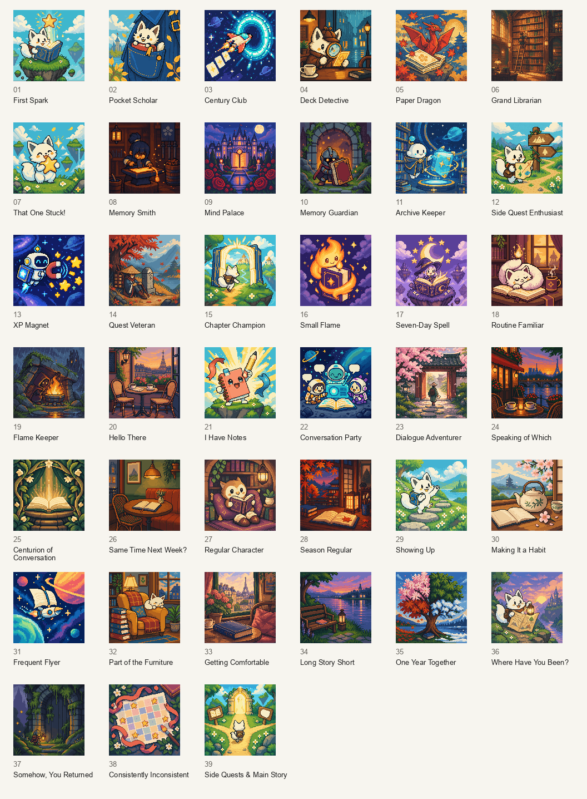

# First Edition — complete achievement artwork

Generated and visually reviewed 18 November 2026. **39 unique artworks complete: 36 visible and 3 hidden**, shared by independent English and Japanese learning collections. This directory is a development asset package, outside the application's public directory. It includes the hidden achievements for owner/developer review.

[Dark-background overview](review/complete-collection-dark.png) · [Generation manifest and prompts](manifest.json) · [Product and popup plan](../../../learning-achievements-plan.md)

## What was produced

- The three existing samples were reused, including the corrected white fox in First Spark. Their source pixels were not regenerated.
- The remaining 36 artworks were generated in six batches through PixelLab Pro Flash, using approved samples for pixel scale, edges and shading while allowing theme-specific palettes and scenes.
- All masters are opaque, static 128×128 PNGs with at most 32 colors. Every artwork has a 64×64 thumbnail and a 256×256 nearest-neighbor review enlargement. Text remains outside the artwork so the same files support both UI languages and learning subjects.
- The app's recurring learner mascot is a white fox. Deliberately different story characters, such as the owl, magical cat, witch and robot, retain their thematic roles.
- One correction removed an extra star from Seven-Day Spell; the final image has seven stars. The superseded output and prompt lineage are retained under `superseded/` and in the manifest.
- This pass used **222 generation units**: 216 for 36 originals and 6 for the star correction. Including the earlier samples and fox correction, the project total is **246 units**. All task-owned generation jobs finished.

## Review and delivery limits

Every new artwork was inspected at 64, 128 and 256 pixels on the light review sheets. The complete collection was inspected at native size on dark surroundings; original samples previously received both-background reviews. Thumbnails retain distinct focal shapes. Some scene details intentionally become visible in the gallery enlargement. The corrected Seven-Day Spell received a confirmation pass. Owner authorization to generate does not imply individual owner approval of every new image.

| Batch | Themes | Light review | Dark review |
| --- | --- | --- | --- |
| 1 | Fox scholars and adventurers | [Sizes](review/batch-1-light.png) | [Sizes](review/batch-1-dark.png) |
| 2 | Space, technology, and converging paths | [Sizes](review/batch-2-light.png) | [Sizes](review/batch-2-dark.png) |
| 3 | Japanese craft, spring, and autumn | [Sizes](review/batch-3-light.png) | [Sizes](review/batch-3-dark.png) |
| 4 | French cafes, palace, and art nouveau | [Sizes](review/batch-4-light.png) | [Sizes](review/batch-4-dark.png) |
| 5 | Streaks, magic, and cozy companions | [Sizes](review/batch-5-light.png) | [Sizes](review/batch-5-dark.png) |
| 6 | Library, loyalty, and hidden returns | [Sizes](review/batch-6-light.png) | [Sizes](review/batch-6-dark.png) |

Native images including embedded prompts total **550,666 bytes (537.8 KiB)**. All thumbnails total **263,357 bytes (257.2 KiB)**. This measures asset size, not application performance. The actual dashboard/gallery must paginate data, lazy-load offscreen images and fetch enlarged artwork on demand. Do not ship review sheets, prompts, superseded files, or the full hidden-art manifest to clients.

No application behavior, schema, runtime dependency or production data changed. The achievement engine, dashboard/gallery and real-time popup still require implementation and the [performance release gates](../../../performance-policy.md). The popup requirement is recorded: immediate display on server-confirmed unlock, brief subtle appearance, click-through details, bounded queues, accessible dismissal, both locales, and authenticated event delivery without constant polling.

## Asset index

| No. | Achievement — English / Japanese | Visibility | Artwork |
| --- | --- | --- | --- |
| 01 | First Spark / はじまりのひらめき | visible | [128 px](native/cards-0001.png) · [64 px](thumbs/cards-0001.png) |
| 02 | Pocket Scholar / ポケットの学者 | visible | [128 px](native/cards-0025.png) · [64 px](thumbs/cards-0025.png) |
| 03 | Century Club / 100枚クラブ | visible | [128 px](native/cards-0100.png) · [64 px](thumbs/cards-0100.png) |
| 04 | Deck Detective / カード探偵 | visible | [128 px](native/cards-0250.png) · [64 px](thumbs/cards-0250.png) |
| 05 | Paper Dragon / 紙のドラゴン | visible | [128 px](native/cards-0500.png) · [64 px](thumbs/cards-0500.png) |
| 06 | Grand Librarian / 大図書館の司書 | visible | [128 px](native/cards-1000.png) · [64 px](thumbs/cards-1000.png) |
| 07 | That One Stuck! / ひとつ、身についた！ | visible | [128 px](native/mastery-0001.png) · [64 px](thumbs/mastery-0001.png) |
| 08 | Memory Smith / 記憶の鍛冶屋 | visible | [128 px](native/mastery-0010.png) · [64 px](thumbs/mastery-0010.png) |
| 09 | Mind Palace / 記憶の宮殿 | visible | [128 px](native/mastery-0050.png) · [64 px](thumbs/mastery-0050.png) |
| 10 | Memory Guardian / 記憶の守り人 | visible | [128 px](native/mastery-0100.png) · [64 px](thumbs/mastery-0100.png) |
| 11 | Archive Keeper / 知識の番人 | visible | [128 px](native/mastery-0250.png) · [64 px](thumbs/mastery-0250.png) |
| 12 | Side Quest Enthusiast / サブクエスト好き | visible | [128 px](native/rank-0005.png) · [64 px](thumbs/rank-0005.png) |
| 13 | XP Magnet / 経験値マグネット | visible | [128 px](native/rank-0010.png) · [64 px](thumbs/rank-0010.png) |
| 14 | Quest Veteran / クエストの達人 | visible | [128 px](native/rank-0025.png) · [64 px](thumbs/rank-0025.png) |
| 15 | Chapter Champion / ひとつの章を越えて | visible | [128 px](native/level-first.png) · [64 px](thumbs/level-first.png) |
| 16 | Small Flame / 小さな炎 | visible | [128 px](native/study-streak-0003.png) · [64 px](thumbs/study-streak-0003.png) |
| 17 | Seven-Day Spell / 7日間の魔法 | visible | [128 px](native/study-streak-0007.png) · [64 px](thumbs/study-streak-0007.png) |
| 18 | Routine Familiar / 習慣の使い魔 | visible | [128 px](native/study-streak-0014.png) · [64 px](thumbs/study-streak-0014.png) |
| 19 | Flame Keeper / 炎を絶やさぬ者 | visible | [128 px](native/study-streak-0030.png) · [64 px](thumbs/study-streak-0030.png) |
| 20 | Hello There / こんにちは、冒険！ | visible | [128 px](native/lessons-0001.png) · [64 px](thumbs/lessons-0001.png) |
| 21 | I Have Notes / メモならあります！ | visible | [128 px](native/lessons-0005.png) · [64 px](thumbs/lessons-0005.png) |
| 22 | Conversation Party / 会話のパーティー | visible | [128 px](native/lessons-0010.png) · [64 px](thumbs/lessons-0010.png) |
| 23 | Dialogue Adventurer / 対話の冒険者 | visible | [128 px](native/lessons-0025.png) · [64 px](thumbs/lessons-0025.png) |
| 24 | Speaking of Which / そういえば、もう50回 | visible | [128 px](native/lessons-0050.png) · [64 px](thumbs/lessons-0050.png) |
| 25 | Centurion of Conversation / 100回の語り部 | visible | [128 px](native/lessons-0100.png) · [64 px](thumbs/lessons-0100.png) |
| 26 | Same Time Next Week? / また来週、この時間に | visible | [128 px](native/lesson-weeks-0004.png) · [64 px](thumbs/lesson-weeks-0004.png) |
| 27 | Regular Character / すっかりおなじみ | visible | [128 px](native/lesson-weeks-0008.png) · [64 px](thumbs/lesson-weeks-0008.png) |
| 28 | Season Regular / ワンシーズンのおなじみさん | visible | [128 px](native/lesson-weeks-0012.png) · [64 px](thumbs/lesson-weeks-0012.png) |
| 29 | Showing Up / 今日も来た！ | visible | [128 px](native/study-days-0010.png) · [64 px](thumbs/study-days-0010.png) |
| 30 | Making It a Habit / いつもの習慣 | visible | [128 px](native/study-days-0030.png) · [64 px](thumbs/study-days-0030.png) |
| 31 | Frequent Flyer / 学びの常連 | visible | [128 px](native/study-days-0100.png) · [64 px](thumbs/study-days-0100.png) |
| 32 | Part of the Furniture / もはや住人 | visible | [128 px](native/study-days-0250.png) · [64 px](thumbs/study-days-0250.png) |
| 33 | Getting Comfortable / ここがしっくり | visible | [128 px](native/loyalty-0003m.png) · [64 px](thumbs/loyalty-0003m.png) |
| 34 | Long Story Short / 気づけば半年 | visible | [128 px](native/loyalty-0006m.png) · [64 px](thumbs/loyalty-0006m.png) |
| 35 | One Year Together / 一緒に歩んだ1年 | visible | [128 px](native/loyalty-0012m.png) · [64 px](thumbs/loyalty-0012m.png) |
| 36 | Where Have You Been? / おかえり、待ってたよ | hidden | [128 px](native/return-0014d.png) · [64 px](thumbs/return-0014d.png) |
| 37 | Somehow, You Returned / 伝説の帰還 | hidden | [128 px](native/return-0090d.png) · [64 px](thumbs/return-0090d.png) |
| 38 | Consistently Inconsistent / 安定の気まぐれ | hidden | [128 px](native/irregular-0001.png) · [64 px](thumbs/irregular-0001.png) |
| 39 | Side Quests & Main Story / サブクエも本編も | visible | [128 px](native/study-and-lessons-week.png) · [64 px](thumbs/study-and-lessons-week.png) |

## Provenance and reproduction

`manifest.json` maps stable achievement IDs to titles, briefs, requests, source/job IDs, sizes, hashes, charges, revision history and review evidence. Every native PNG has a JSON sidecar and its exact generation/edit prompt embedded with Impeccable. `jobs/` holds the 36 new-asset receipts; the corrected star asset points to its latest job and retains the initial request in its revision history. No credentials are stored.

Run `python3 docs/assets/achievements/first-edition/build-review.py` to recreate exports and review sheets from the existing PNGs. This local-only helper uses Pillow and the installed Impeccable prompt metadata helper. It validates dimensions, opacity, color bounds and unchanged source pixels after embedding metadata. It makes no generation/API calls. No preview server or background process is required.
